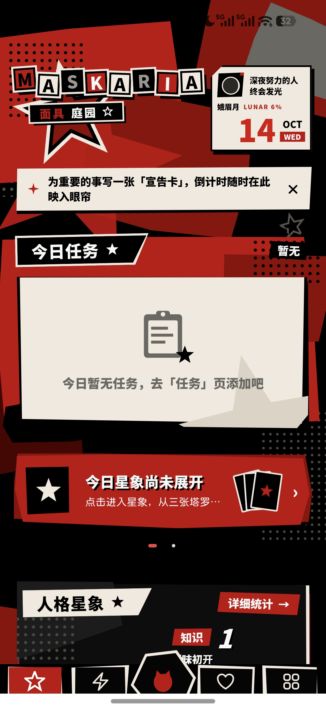
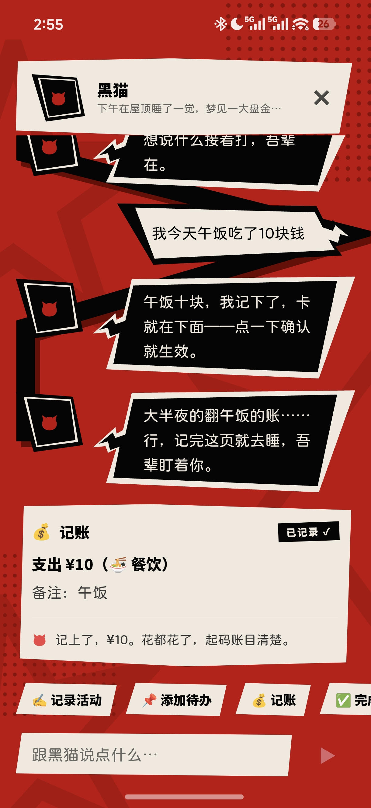
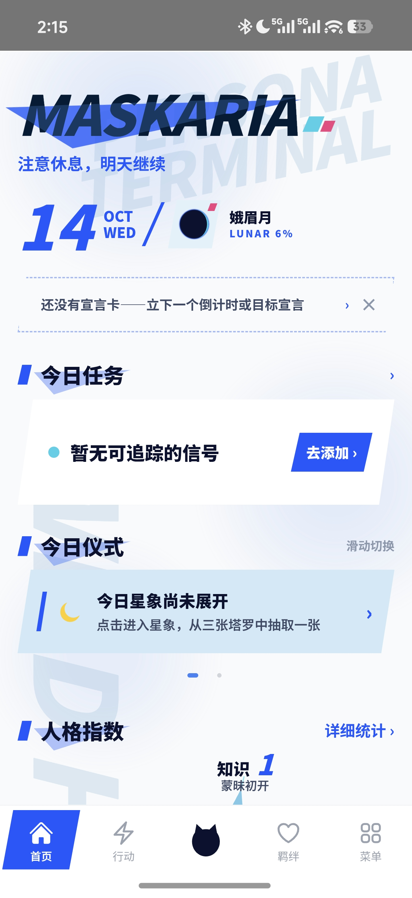

<p align="center">
  
</p>

<h1 align="center">MASKARIA · 面具庭园</h1>
<p align="center"><em>把日子过成存档，把存档过成人样</em></p>
<p align="center">当前 Android 正式版：<strong>v2.8.14</strong>（Web 已同步）</p>

<p align="center">
  
  
  
  
  
  
</p>

---

> 「你已经在不知不觉间，积攒了很多东西。」
>
> 这句话一般没人对你说。

也没人会对你说：你熬的那些夜算数，你看的那几章书算数，你压下没发出去的那通火也算数。
这些东西不会自己留下痕迹，久了连你自己都忘了。到最后你会觉得，那几年里你好像什么都没干。

**MASKARIA 就是干这个的。它替你把痕迹留下来。**

它没法让你变强。**没有任何软件能做到那个。** 它只做一件很小的事：
你说"今天看了二十页书"，它记下来，给你加 0.5 点知识。

就这 0.5 点。有时候能顶住很多东西——因为大多数人不是不想努力，
是**努力过，但没人看见**。

——这也是为什么它有个挺中二的设定：你真实的成长，会长成一张**人格面具**。

> 这东西最初是做给一个人自己的。他不太想再忘记自己干过什么。

---

## 它不是什么

先说清楚，省得你抱错期待：

- **不是待办清单**（虽然它能记任务，还分每日重复和长期目标）
- **不是记账 App**（虽然它记账记得很认真，连"今天还能花多少"都替你算好）
- **不是自律工具**（它不负责励志——那事儿它干不了，也不打算假装能干）
- **不是那种会推送「你今天还没努力哦」的东西**

它不催你。它就安静待在那儿，像一个知道你已经很累了的朋友。

---

## 它能干什么

### 五个属性，从零开始长

知识、胆量、灵巧、温柔、魅力。

**名字你随便改**——改成"体重""存款""发际线"也行，它不会拦你，也不会多问一句。

每做一件事，往上加一点。加着加着就升级了。升级解锁技能，技能激活后，
对应属性的加点还能再涨一点。就是这么一个朴素到有点笨的循环。

### 记一笔

用大白话描述你干了什么："看了二十页书""跟人吵了一架但忍住了"。
系统猜该加哪一项，猜错了你自己改。

可以补记一周内的旧账——**毕竟你也不是每天都记得上来写，人嘛。**
支持重要标记、日历热力图、按年月日归档、全文搜索。

> 就算你今天只学了十分钟，它也会认真给你加上那零点几分。
> 它不评价你做得够不够。**评价是你自己的事，它只负责记账。**

### 任务

绑定属性与点数，完成后自动加点。「每日重复」养习惯，「长期目标」记累计次数，
「本周目标」盯住这一周的推进。

**BIG DEAL** 是给"大事"准备的：拆成若干小步，一步一步勾掉，收官时一次性结算，
顺便放一段庆祝动画——**就当这世上还有人记得你干成了这件事。**

还没想清楚的事，先写成**愿望**存着；想动手了再转成任务。
实在选不定先做哪个，让「命运抽签」替你挑。它挑，你服从，出了事不用你负责。

### 宣告卡

为重要的事立一张卡：倒计时、目标宣言，钉在首页，每天映入眼帘。
临期提醒，收官有专属演出。

**这是在给自己的未来写欠条。** 欠条这东西，写的时候总是有点心虚的。

### 记账

一句话记一笔，"午饭十块"这种它也认；一句话里好几笔也能拆开。

真实总余额、月度预算环、"今天还能花多少"、资产板块、月末结算。
「成长」类的花销会反过来给你加属性点——**花在自己身上的钱，不算白花。**

> 记账流水按设计**永不上传**，只存在你自己的设备里。

### 同伴

用 22 张大阿卡纳代表你身边重要的人。记一次互动涨一点亲密度，
等级上去解锁道具与日常加成。

每天可以向同伴祈愿（凌晨四点重置——这个时间点挺懂事的，那会儿大多数人已经睡了）。

登录后输入对方 UserID 可以缔结约定，双向同步。
**意思是，你不再是单机游戏。**

### 逆影战场

"影时间"降临时，暗影出现。

召唤属于你的「面具」，给五项属性各绑一套技能，出招看局势：伤害、暴击、蓄力、易伤。
想往深处走就顺着高塔一层层往上爬，最深处是走不到头的深渊回廊。

> 这个玩法存在的唯一意义是：让你在现实里受了气之后，有个地方能名正言顺地打回去。
>
> 打不打得过是另一回事。

### 星象

每天三选一抽一张塔罗，给一段运势和一句建议，顺手给某个属性加成。
另有持续十四天、可以追问一次的中长期占卜。

图鉴收录完整 78 张塔罗牌；岁时册提供四主题的 24 节气与 20 节日卡面。
占卜档案直接显示已抽中的牌图，并保留正逆位；红主题背景动画保留原有暗红块、网点和星纹。
手机庆祝演出的大装饰使用固定纹理，弹窗期间暂停背景动画、关闭后恢复；开发启动排除安装包目录的扫描和热重载。

**没配 AI 也能抽**——有离线解读兜底，不至于让你对着一个转圈的加载图标发呆。

### 统计与 AI 回望

人格指数五角星随成长伸展；连续天数、热力日历、属性曲线一目了然。

配上 AI 之后，它能生成**每周 / 每月的成长总结**——替你回头看一眼这段时间的弧线。
写得还挺像回事，偶尔会有那种"被说中了"的感觉。

（当然，也可能写得像个只会说好话的亲戚。AI 就这水平，别对它期待太高。）

### 助手

住在底部中央 ◈ 里的对话式助手。说人话就能记账、加任务、写记录；
它记得你手头在做的事，会在合适的时候提一句。

人格可以换，也可以自己捏一个。**聊天原文只存在你的设备上，永不上传。**

### 桌面小组件（Android）

清单组件：今日任务 + 完成进度 + 倒计时，4×2 与 2×2 两种规格，跟随夜间模式。

---

## 主题

四套视觉语言加一套自定义。

**换主题不是换色号，是换一整套设计语言**——连按钮的说法都跟着变
（红色的世界里，完成叫"夺回"，删除叫"撕掉"）。

| 主题 | 语言 |
|------|------|
| 蓝 · 粉 | **白日水面** —— 近白底、斜切平行四边形、超大黑斜体、背景幽灵英文大字 |
| 黄 | **今日节目单** —— 高饱和黄舞台、衬线大标题、花瓣雷达、实景云天空 |
| 红 | **剪报怪盗** —— 纯黑舞台、猩红斜块碰撞、半调网点、撕纸卡、拼贴瓷砖标题 |
| 自定义 | 中性皮，整族从你选的主色派生 |

每套都配了自己的长按轮盘、庆祝演出、页间转场、按压反馈和夜间模式。
Android 端连**桌面图标**都会跟着主题换。

---

## 版本更新日志

以下从首个 Android 安装包开始，按版本顺序记录 MASKARIA 的主要更新。

### v2.8.6

- 修复部分鸿蒙设备记账完成标题显示不完整的问题。
- 更新 Android 版本标识，便于识别新构建并覆盖升级。

### v2.8.7

- 重做首次使用引导，加入塔罗浮牌、翻牌转场及建档完成演出。
- 新增引导页月相、本机时钟与影时间状态展示。
- 修复首次建档提交时可能发生的崩溃。
- 修复 Android 据点座位、组织成员牌面、好友卡等位置的远程头像无法显示的问题。

### v2.8.8

- 新增蓝、粉、红、黄主题对应的羁绊全屏升级演出与庆祝页面。
- 更新星移界面及转场，完善升级、庆祝、星移之间的衔接。
- 完善红主题同伴档案、今日互动及在线同伴资料卡的视觉表现。
- 修复升级演出被弹窗遮挡、播放顺序异常及卡牌显示不稳定的问题。
- 修复部分卡牌尺寸与牌框不匹配的问题。
- 修复黄色主题在短屏设备上“继续收看”按钮超出屏幕、无法点击的问题。

### v2.8.9

- 修复蓝、粉主题升级演出中确认按钮过早出现、动画尚未结束就切页的问题。
- 优化动画调度，改善卡顿后多个元素同时跳出的表现。
- 优化红、黄主题手机端特效，减少粒子、模糊与大面积图层开销。

### v2.8.10

- 修复蓝、粉主题升级演出在互动弹窗关闭前提前播放的问题。
- 调整演出结束与确认按钮的衔接，确保主要动画及退场完成后再进入下一步。
- 汇总移动端动画优化，提供新的 Android 验收包。

### v2.8.11

- 修复红主题羁绊升级进场时背景闪烁、反复切回原页面的问题。
- 修复数据刷新可能导致升级演出重新开始的问题。
- 调整手机端进场方式，改善演出稳定性。

### v2.8.12

- 更新邮箱验证码邮件及红主题验证码输入页，采用 P5 预告函设计、逐字剪贴效果与主题文案。
- 修复云端登录失效后仍显示已登录的问题，新增失效提示，保留本机数据。
- 修复旧请求返回错误时，可能误清除新登录状态的问题。
- 修复网页版更新后仍可能加载旧页面的问题。

### v2.8.13

- 补齐四套主题的 78 张塔罗牌图鉴，新增小阿卡纳牌面与对应分组。
- 中长期占卜、档案和相关牌面入口统一使用主题牌图，保留图片加载失败时的程序化兜底。
- 更新 Android 与 Web 正式包，完整包含四套主题塔罗资源。

### v2.8.14

- 新增四套主题的岁时册卡面，包含 24 节气与 20 节日，共 176 张卡图。
- 占卜档案缩略图改为显示实际抽中的牌面，并保留正逆位方向。
- 修复红主题动画舞台透出灰底、背景装饰丢失和记录成功中间帧闪烁的问题。
- 修复庆祝、记录完成与羁绊升级期间背景动画暂停及恢复不一致的问题。
- 优化开发启动时的依赖扫描与热重载，减少安装包目录引起的额外转换。
- 同步更新 Android 正式包与网页版。

*注：v2.8.9、v2.8.10 为阶段性修复与验收版本，相关改动均已包含在后续正式版本中。*

---

## 看起来什么样

<p align="center">
  
  &nbsp;
  
  &nbsp;
  
</p>

<p align="center"><sub>红色主题首页 · 助手记账 · 蓝色主题首页（同一套界面，四套设计语言）</sub></p>

---

## 怎么跑起来

**前端**

```bash
npm install
npm run dev          # 开发，http://localhost:5173
npm run build        # 构建到 dist/
npm test             # 单元测试
npm run typecheck    # 类型检查
```

**后端**（需要 MySQL 8）

```bash
cd backend
mvn spring-boot:run  # 启动，http://localhost:8080
mvn test             # 测试（集成测试跑在独立测试库上）
```

首次启动自动建表——库结构用 Flyway 版本化管理，不用手工执行 SQL。

**移动端**（Android）

```bash
npm run build
npm run cap:sync           # 把前端产物同步进 Android 工程
npm run cap:build:android  # 打包
```

生成可覆盖安装的正式包：

```powershell
.\scripts\build-release.ps1
```

脚本显式使用正式后端地址，并在同步到 Android 前检查构建产物，拒绝包含 localhost 的正式包。后端迁移时用 `-ApiUrl '新的正式地址'`，不要依赖本机开发环境配置。

当前线上版沿用 Android Debug 证书，脚本会使用同一张证书以保证新包可覆盖升级。以后迁移到应用商店私钥时，再附加 `-KeystorePath` 并按提示在本机输入签名信息；密码不会写入仓库、日志或命令历史。

> **音效与部分场景图不随本仓库分发**：`public/` 下需自备若干 UI 反馈音与黄频道实景图
> （文件名见 `src/utils/feedback.ts`、各处 `playSound()` 调用与 `public/assets/terminal/`）。
> 缺失时会静默降级——音效不响、背景留白，不影响其它功能。

---

## 技术形态

| 层 | 实现 |
|---|---|
| 前端 | React 18 · TypeScript 5 · Vite 5 · Tailwind 3 · Zustand · Dexie |
| 动效 | motion/react + GSAP；PWA 由 vite-plugin-pwa 生成 |
| 后端 | Java 17 · Spring Boot 3 · MyBatis-Plus · MySQL 8 · Spring Security + JWT · Flyway |
| 客户端 | Capacitor（Android，含桌面小组件与本地通知） |
| 数据 | **默认全部存在本机**；云同步可选，且按类目开关 |

**两条硬规矩**：

1. **记账流水、聊天原文、记录配图、导入的音乐——按设计永不上传**，只在你自己设备上。
2. **AI 是你自带的**：Key 存本机，不上云、不进日志；服务端只提供可选的转发通道，
   且默认不持有任何服务商的密钥。

---

## 完成度

前端 `npm test` **45 个测试文件 / 286 项**通过，`tsc --noEmit` 零报错；
后端 `mvn test` **159 项**通过（集成测试跑在独立测试库，不碰应用库）。
数据库迁移 13 个版本，从空库到可用一键完成。

**已验证**：注册 / 邮箱验证码 / 邮件重置密码 / 注销账号、记录与撤销、任务、记账、愿望、星象、
同步与冲突处理、备份导出与恢复、五套主题切换、Android 打包与安装。

**还欠着**：iOS 没做（Apple 开发者账号太贵，这个理由够诚实）；
Android 的通知与小组件只在真机上跑过基本路径，各家国产 ROM 的后台策略仍是未知数。

**没做好的**：性能。首屏和页面切换还有可感知的卡顿，
重的地方一时半会儿改不动——这是个自己给自己用的东西，作者选择先让它能用。

---

## 协议与致谢

代码按 **GPL-3.0-or-later** 发布（见 [LICENSE](LICENSE)），另附两条附加许可（见 [NOTICE](NOTICE)）：
允许通过应用商店分发；允许与 GSAP 链接。

名称「MASKARIA」、图标与美术素材**不在 GPL 范围内**，保留所有权利，见 [ASSETS_LICENSE](ASSETS_LICENSE)。

欢迎提 PR。请用 `git commit -s` 带上 `Signed-off-by`（即 [DCO](https://developercertificate.org/)），
表示这段代码你有权提交。

---

<p align="center"><sub><strong>二次创作与致谢</strong></sub></p>

<p align="center"><sub>
本项目基于开源项目 <a href="https://github.com/YuukiMarine/the-velvet">the-velvet（靛蓝色房间）</a>
二次创作，向原作者 <strong>YuukiMarine</strong> 致谢。按 GPL-3.0-or-later 的要求保持同样协议开源，
并保留上游版权声明（见 <a href="NOTICE">NOTICE</a>）。<br/>
界面与命名借鉴 Persona 系列，谨向 ATLUS / SEGA 致敬；本项目为粉丝向个人作品，
与上述公司无关，亦未获其认可，请勿用于商业用途。
</sub></p>

---

<p align="center"><sub>
写给那种明明什么都做不好、却还是每天早上爬起来的人。<br/>
——也算写给写这个软件的人自己。
</sub></p>

<p align="center"><sub>
如果有一天它帮到了别人，那挺好。<br/>
但它最开始，只是一个人不想再忘记自己干过什么。
</sub></p>
