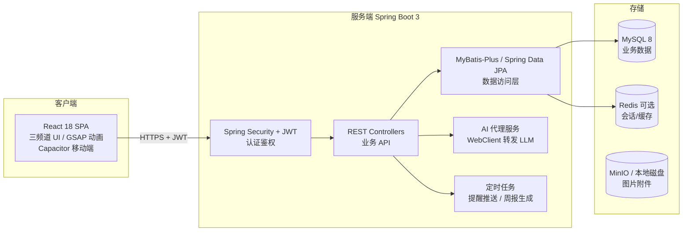

# 「MASKARIA」Java 全栈化改造策划书（毕业设计）

## 一、项目概述

**项目名称**：MASKARIA（面具庭园）——基于 Spring Boot + React 的个人成长追踪系统

**现状**：本项目现有一个已完成的高完成度 React 18 前端（TypeScript + Vite + Tailwind + Zustand + Dexie/IndexedDB + GSAP/motion 动画 + Capacitor 移动端封装），含 16+ 页面、200+ 组件、三套主题皮肤（P3/P4/P5 视觉系统）、塔罗/AI 对话等 AI 功能。数据目前存于浏览器 IndexedDB，云同步依赖第三方 PocketBase（Go 编写）。

**改造目标**：**前端界面完全保留不动**，用 Spring Boot 从零构建后端服务，替换 PocketBase 与浏览器本地存储，形成「React SPA + Spring Boot REST API + MySQL」的标准前后端分离全栈架构。

### 为什么前端不需要重写

现有前端是标准 SPA（`npm run build` 产出静态文件 dist/），它不关心后端是什么语言写的——只要 HTTP 接口的请求/响应格式对上，React 代码一行不用改。改造工作就是把「浏览器 IndexedDB 读写」和「PocketBase SDK 调用」这两类数据访问点，改接到自研 Java API 上。

## 二、总体架构



## 三、前端改造点（极少量）

| 改动 | 现状 | 改为 | 涉及文件 |
|---|---|---|---|
| 数据读写 | `src/store/index.ts` 直接操作 Dexie/IndexedDB | 抽出 `api/` 层，调 REST API（保留离线缓存可选） | store/index.ts、services/ |
| 云同步 | `src/services/` 调 PocketBase SDK | 调自研 `/api/sync` 接口 | services/cloud.ts 等 |
| 用户认证 | PocketBase auth | JWT 登录/注册/改密，token 存 localStorage | services/auth.ts |
| AI 调用 | 浏览器直连 LLM API（key 暴露在前端） | 改调后端 `/api/ai/*`，key 存服务端 | utils/*AI.ts |

其余 200+ 组件、三频道皮肤、动画、音效——**零改动**。

## 四、后端设计（Spring Boot 3 + Java 17）

### 4.1 模块划分

```
persona-terminal-server/
├── controller/     # AuthController, ActivityController, WishController,
│                   # TodoController, TarotController, BattleController,
│                   # LedgerController, SyncController, AiProxyController
├── service/        # 业务逻辑（成长值结算、愿望进度、战斗判定、周报生成）
├── mapper|repo/    # MyBatis-Plus Mapper（或 JPA Repository）
├── entity/         # 数据库实体
├── dto/            # 请求/响应对象
├── config/         # SecurityConfig, CorsConfig, MybatisPlusConfig
└── task/           # 定时任务（@Scheduled：每日提醒、塔罗刷新）
```

### 4.2 核心数据表（由 src/types/index.ts 的 90+ 个 interface 归纳）

| 表 | 来源类型 | 说明 |
|---|---|---|
| user | User | 用户、主题偏好、属性五维 |
| activity | Activity | 行为记录（成长点数来源） |
| wish | Wish | 愿望（含进度曲线 JSON 字段） |
| todo | Todo / TodoStep / TodoCompletion | 待办与步骤，多频次 |
| achievement | Achievement | 成就 |
| tarot_reading | DailyDivination / LongReading / FateGlimpse | 塔罗抽牌与解读 |
| battle + persona | Persona / PersonaSkill / RelicInstance | 逆影战斗、面具、遗物 |
| ledger_* | LedgerEntry / Budget / LedgerAsset | 记账 |
| quest | Quest | 任务模板 |
| summary | PeriodSummary / YearRecap | 周期总结 |
| settings | Settings | 用户设置（JSON 列） |
| sync_log | — | 多端同步水位 |

设计要点：复杂嵌套结构（Wish.progressPoints、Settings、NavigatorSession）用 MySQL `JSON` 类型列存储，与前端 TS 类型直接对应，避免为 90+ 接口全部建关系表——这是毕设答辩时「关系建模 vs JSON 灵活性」的好论点。

### 4.3 关键技术点（答辩亮点）

1. **JWT 无状态认证** + Spring Security 过滤器链（对比原 PocketBase 的 auth，说明自研原理）
2. **AI 代理层**：前端不再持有 LLM API key，后端 WebClient 统一转发，可加限流/缓存——安全性与成本控制的双收获
3. **数据迁移**：IndexedDB → MySQL 的一次性迁移脚本（Node 侧导出 JSON → Java 导入），答辩可演示
4. **离线优先降级**：Capacitor 移动端弱网时回落本地 Dexie，恢复后走 `/api/sync` 增量同步（updated_at 水位）
5. **定时任务**：Spring `@Scheduled` 实现每日塔罗重置、待办提醒推送

### 4.4 技术栈清单

| 层 | 选型 |
|---|---|
| 框架 | Spring Boot 3.2 + Java 17 |
| ORM | MyBatis-Plus（国内毕设主流）或 Spring Data JPA |
| 数据库 | MySQL 8 |
| 认证 | Spring Security + JJWT |
| AI 转发 | Spring WebClient |
| 文档 | SpringDoc OpenAPI（自动生成接口文档，答辩加分） |
| 构建 | Maven |
| 部署 | 前端 dist/ 由 Nginx 托管，后端 jar + systemd/Docker |

## 五、开发计划（约 6-8 周）

| 周 | 内容 | 验收 |
|---|---|---|
| 1 | 工程搭建、数据库设计、Security+JWT 登录注册 | Postman 走通认证链 |
| 2 | 用户/设置/主题接口，前端 auth.ts 切换 | 前端登录真实可用 |
| 3 | 核心 CRUD：activity/todo/wish | 前端主要页面出真数据 |
| 4 | 塔罗 + AI 代理层 | AI 功能后端化 |
| 5 | 战斗/成就/记账模块 | 全功能接口完备 |
| 6 | IndexedDB 迁移脚本 + 同步接口 | 旧数据完整迁移演示 |
| 7 | 联调测试、Nginx 部署、安卓包重打包 | 移动端连真实后端 |
| 8 | 论文整理、接口文档、答辩准备 | — |

## 六、风险与对策

| 风险 | 对策 |
|---|---|
| store/index.ts 300KB+，数据访问点分散 | 先写 `api/` 适配层收敛，store 逐模块切换，每步可回退 |
| 90+ 类型全部建表工作量爆炸 | JSON 列 + 核心表关系化，混合建模 |
| 前端离线逻辑与后端同步冲突 | 毕设范围可先做「在线为主 + 登录同步」，离线增量同步列为展望 |
| GPL 合规 | 前端沿用需保留 YuukiMarine 署名（NOTICE/README），论文中注明二创来源 |

## 七、毕设论文映射

- 需求分析 ← README 功能清单 + 现有 16 页面
- 概要设计 ← 本文架构图 + 模块划分
- 详细设计 ← 4.2 数据表 + REST 接口清单（SpringDoc 自动导出）
- 系统实现 ← 关键代码：JWT 过滤器、AI 代理、同步水位算法
- 测试 ← Postman 集合 + 前端 E2E 走查
- 特色与创新点：游戏化成长模型、三频道动态主题系统、AI 叙事代理、离线优先同步
